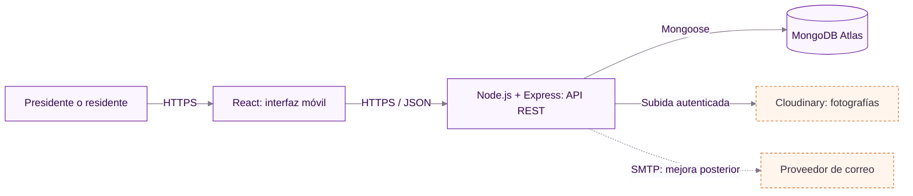
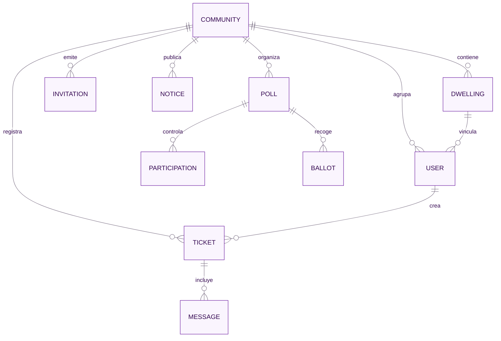

# Viabilidad técnica

  

Requisitos, arquitectura y decisiones del prototipo, con el modelo de datos previsto para las próximas funciones.

## Índice

- [1. Requisitos funcionales y prioridades](#1-requisitos-funcionales-y-prioridades)
- [2. Arquitectura y decisiones técnicas](#2-arquitectura-y-decisiones-técnicas)
- [3. Modelo preliminar de MongoDB](#3-modelo-preliminar-de-mongodb)
- [4. Capacidades y viabilidad](#4-capacidades-y-viabilidad)
- [5. Riesgos y mitigación](#5-riesgos-y-mitigación)

## 1. Requisitos funcionales y prioridades

El MVP comprende todos los requisitos **Must**. Los Should se incorporarán solo después de verificar el recorrido esencial; no son condiciones de aceptación del MVP.

| ID | Prioridad | Requisito verificable |
| --- | --- | --- |
| F1 | Must | Registrar y autenticar usuarios; el presidente crea una comunidad y sus viviendas. |
| F2 | Must | Generar enlace con token y QR; un residente se registra y solicita la vivienda elegida. El presidente valida la vinculación antes de habilitar la participación. |
| F3 | Must | El vecino crea una incidencia con título, descripción, categoría y foto opcional; consulta sus incidencias. |
| F4 | Must | El presidente consulta incidencias de su comunidad y cambia su estado entre pendiente, en trámite y resuelta. |
| F5 | Must | Autor y presidente intercambian mensajes privados en cada incidencia. |
| F6 | Must | El presidente publica avisos; los miembros de la comunidad los consultan sin comentarios públicos. |
| F7 | Must | El presidente crea y cierra consultas con opciones; una vivienda validada emite como máximo una respuesta y consulta el resultado agregado tras el cierre. |
| F8 | Must | El servidor comprueba autenticación, rol, pertenencia y acceso al recurso en cada operación; la interfaz se adapta al móvil. |
| F9 | Should | Enviar correo por aviso urgente o incidencia resuelta. |
| F10 | Should | Filtrar incidencias por estado y categoría; descargar el QR para imprimirlo. |
| F11 | Could | Actualizar el estado de la vista mediante sondeo periódico; indicadores de participación y accesibilidad adicional. |
| F12 | Won't | Contabilidad, pagos, reservas, técnicos externos, varias comunidades por usuario o voto ponderado. |

Una invitación demuestra posesión del enlace, no residencia: la validación del presidente reduce altas indebidas, pero no constituye una verificación de identidad. El diseño de consultas admite varios residentes por vivienda, con una sola respuesta. La rama actual de alta por QR limita la vinculación a una cuenta por vivienda. El presidente puede participar si tiene una vivienda validada. Los resultados se consultan al cerrar y las consultas son orientativas.

## 2. Arquitectura y decisiones técnicas

La figura 1 sitúa la interfaz, la API y la base de datos dentro de la arquitectura prevista. Las fotografías y el envío de correo forman parte del diseño posterior.

*Figura 1. Arquitectura de Moravía. El contorno discontinuo identifica los servicios previstos.*

Usamos React y Vite para el cliente. En las ramas del panel, las vistas se seleccionan según la URL y el estado de sesión. La interfaz se adapta con CSS y usa `fetch` para llamar a la API.

Express valida las entradas y comprueba los permisos en servidor. La sesión usa un JWT en una cookie `HttpOnly`, con `SameSite` configurable y `Secure` cuando corresponde. Las peticiones que cambian datos requieren un token CSRF. Guardamos las contraseñas con hash y sal mediante bcrypt y las credenciales de los servicios en variables de entorno. Los detalles están en la [guía del backend](../backend/README.md).

Los mensajes se recuperan al abrir o actualizar la incidencia; no se promete entrega en tiempo real. Las imágenes requieren validación de tipo y tamaño en servidor y acceso restringido mediante entrega autenticada o URLs firmadas de corta duración; una URL pública permanente no cumple la privacidad prevista. Si no se puede configurar esta protección, se desactiva la subida hasta resolverla. El servidor no conserva archivos en disco como almacenamiento permanente.

## 3. Modelo preliminar de MongoDB

El diagrama reúne las colecciones actuales y las que prevemos incorporar para avisos y consultas.

*Figura 2. Relaciones del modelo preliminar. La tabla recoge los campos y las reglas de cada colección.*

| Colección | Campos principales y tipos | Reglas |
| --- | --- | --- |
| `communities` | `_id: ObjectId`, `name: String`, `address: String`, `presidentId: ObjectId`, `createdAt: Date` | Presidente referencia a usuario de la comunidad. |
| `dwellings` | `_id`, `communityId: ObjectId`, `label: String` | Índice único `(communityId, label)`. |
| `users` | `_id`, `communityId`, `dwellingId: ObjectId`, `name`, `email`, `passwordHash`, `role`, `membershipStatus: String` | Correo único normalizado; rol presidente/vecino; alta pendiente o validada. |
| `invitations` | `_id`, `communityId`, `tokenHash: String`, `expiresAt: Date`, `createdBy: ObjectId` | Una invitación por comunidad. Guardamos el hash y el índice TTL limpia los registros caducados. |
| `tickets` | `_id`, `communityId`, `authorId: ObjectId`, `title`, `description`, `category`, `status: String`, `imageId: String/null`, `createdAt: Date`, `messages: Array` | Mensaje embebido: `authorId: ObjectId`, `body: String`, `createdAt: Date`; limitar tamaño y paginar o extraer a colección si crece. Índice por comunidad y estado. |
| `notices` | `_id`, `communityId`, `authorId: ObjectId`, `title`, `body: String`, `createdAt: Date` | Solo publica el presidente; lectura limitada a miembros. |
| `polls` | `_id`, `communityId`, `authorId: ObjectId`, `question: String`, `options: Array<{id: String, label: String}>`, `closesAt: Date`, `status: String` | Opciones inmutables después del primer voto; cierre efectivo comprobado en servidor. |
| `participations` | `_id`, `pollId`, `dwellingId: ObjectId` | Índice único `(pollId, dwellingId)` impide duplicados. No contiene opción. |
| `ballots` | `_id`, `pollId: ObjectId`, `optionId: String` | No contiene usuario ni vivienda; se cuenta por opción tras cerrar. |

MongoDB permite guardar juntos los datos que se consultan a la vez, como los mensajes de una incidencia. Las entidades compartidas se guardan por referencia. Para las consultas prevemos guardar el voto y la participación en una transacción e impedir duplicados mediante un índice único. Antes de aceptar un voto habrá que comprobar la pertenencia, la validación de la vivienda y el plazo. Las pruebas previstas incluyen concurrencia y reversión.

> [!IMPORTANT]
> En el modelo previsto, separar participación y respuesta reduce la vinculación directa. En grupos pequeños, el recuento o las horas de las operaciones pueden permitir deducciones. Mostraremos los resultados tras el cierre.

### Justificación del modelo NoSQL frente a relacional (SQL)

MongoDB permite guardar los mensajes acotados dentro del ticket y recuperar la incidencia completa en una lectura sin unir tablas. Las opciones de una consulta se modelan como un array, sin una tabla intermedia, y los documentos BSON se corresponden de forma natural con los objetos intercambiados en JSON por Express y React. La fragmentación permite escalar horizontalmente en otros niveles de servicio, aunque Atlas Free no la admite.

Estas ventajas dependen del patrón de acceso: SQL también puede modelar mensajes y opciones con garantías sólidas, y un JOIN no es necesariamente costoso. La velocidad debe medirse, no suponerse. El límite de tamaño de los documentos exige acotar los mensajes o extraerlos a una colección cuando crezcan.

## 4. Capacidades y viabilidad

Rocío tiene un nivel general de desarrollo de 3/5 y de 4,5/5 en diseño, maquetación, UX y accesibilidad. Pablo tiene un nivel general de 2,5/5 y de 1,5/5 en diseño/CSS y despliegue. La escala es orientativa: 1 representa conocimientos iniciales y 5 dominio avanzado. Los niveles generales no equivalen a una valoración independiente de cada herramienta.

| Tecnología / área | Rocío (1–5) | Pablo (1–5) | Laguna y estrategia semanal |
| --- | ---: | ---: | --- |
| Diseño, maquetación, UX y accesibilidad | 4,5 | 2,5 | Rocío guía una revisión semanal de accesibilidad y diseño adaptable. |
| React y desarrollo frontend | 3 (general) | 2,5 (general) | Practicar componentes, formularios y rutas mediante una tarea conjunta por sprint. |
| Node, Express y seguridad | 3 (general) | 2,5 (general) | Revisar semanalmente una ruta y sus pruebas de autorización. |
| MongoDB y Mongoose | 3 (general) | 2,5 (general) | Prototipar índices y `withTransaction` y revisar los resultados durante el sprint de consultas. |
| Despliegue e imágenes | 3 (general) | 2,5 | Rocío apoya el despliegue; ambos prueban accesos privados de Cloudinary y repasan fallos en cada revisión. |

La planificación comprende seis sprints, 72 horas-persona comprometidas y defensa el 18 de diciembre de 2026. El equipo prioriza los requisitos Must; las ampliaciones se abordarán después del núcleo y los avances se revisarán semanalmente.

## 5. Riesgos y mitigación

| Riesgo | Probabilidad / impacto estimados | Mitigación y comprobación |
| --- | --- | --- |
| Acceso a datos de otra comunidad o a mensajes privados | Media / alto | Comprobar comunidad y autorización en cada consulta; pruebas de acceso cruzado con ambos roles. |
| Duplicación de votos o escritura parcial | Media / alto | Índice único y transacción; pruebas concurrentes y de fallo intermedio. |
| Deducción del voto en grupos pequeños o por registros | Alta / alto | Agregar al cierre, minimizar registros y explicar límites; no prometer anonimato absoluto. |
| Enlace de invitación compartido fuera de la finca | Media / alto | Token revocable y caducable; presidente valida vínculo y puede revocarlo. |
| Imágenes privadas expuestas | Media / alto | Almacenamiento privado, validación y enlaces firmados; probar acceso sin autorización. |
| Desconocimiento de transacciones o despliegue | Media / medio | Prototipo técnico temprano y trabajo en pareja; revisar compatibilidad antes de desarrollar votaciones. |
| Plazo o carga del equipo insuficientes | Alta / alto | Medir horas y avance semanal; terminar Must primero y aplazar mejoras. |
| Límites o parada de servicios gratuitos | Media / medio | Vigilar almacenamiento y transferencia, generar alertas, limitar cargas y preparar demostración local con datos ficticios. |
